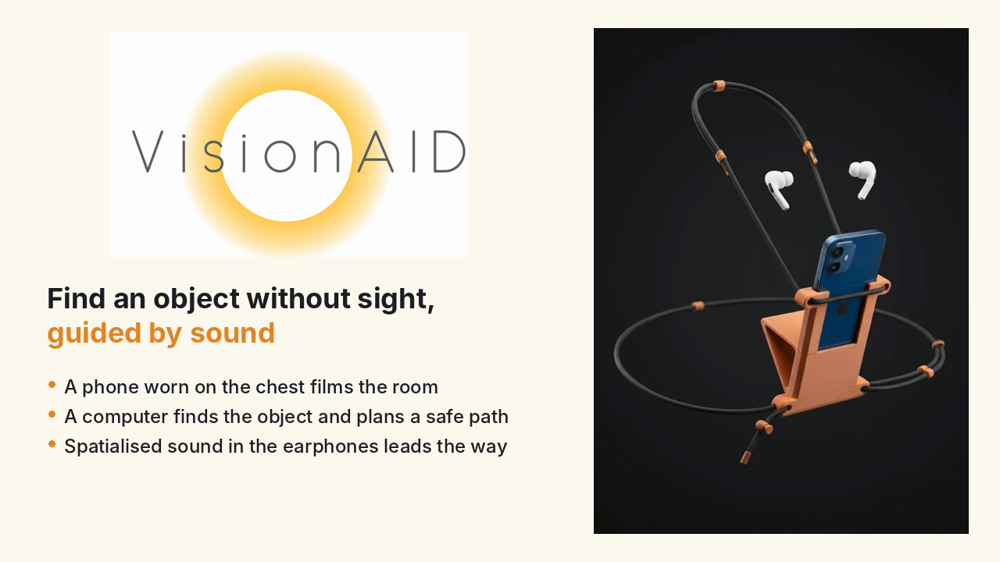

# VisionAId — finding your things by sound 🔊

**🏆 Jury Prize — Hack1robo 2026** (Art · AI · Robotics · Cognitive Science hackathon, Bordeaux, 20-22 November 2026)

VisionAId helps blind and visually impaired people **find an everyday object** ("where is my water bottle?").
A phone worn on the chest films the room; a computer detects the object, builds a 3D map of the room, plans a safe path, and **guides the person with sound** in their earphones, plus a few short spoken messages.

> This repository is the **English version** of the project, forked from the team repository **[SonDePoisson/VisionAid](https://github.com/SonDePoisson/VisionAid)**.
> It adds English documentation and a **second hardware setup**: Windows PC without GPU + Android phone.
> ⚖️ Please read the **[licence notice](NOTICE.md)**: the original code has no licence and remains the property of its authors.



---

## 👥 Team

| Member | Role |
|---|---|
| **Sarah Husson** | Project sponsor, lead developer |
| **Clément Poisson** | Project sponsor, developer |
| **Romain Benoit** | Designer (guidance sounds, user experience) |
| **Corinne Bergès** | AI developer (live tests on real devices, Windows + Android setup, technical documentation, English version) |

Sarah and Clément started VisionAId for their grandmothers, who now have low vision.

---

## 🧩 How it works

```
Phone (web page)                    PC (Python, multi-process real-time graph)
 camera ~10 fps     ─┐
 gyro + accel 60 Hz ─┼─ WebSocket ─► perception: YOLOE detection + DINOv2 re-identification
 "Speak" button     ─┘             ─► geometry:   Depth Anything V2 depth + visual-inertial pose
                                    ─► world:      floor, occupancy map, object anchor, furniture
                                    ─► planner:    D* Lite, through known free areas only
                                    ─► guidance:   state machine, smoothed direction, sounds + voice
 stereo sound + voice ◄──────────────┘  (~20 sound commands per second)
```

- **No app to install**: the phone opens a web page served by the PC (HTTPS with a local certificate authority).
- **Open-vocabulary detection**: describe the object in words, no retraining.
- **"My" bottle, not any bottle**: re-identification with reference photos and a colour score.
- **One camera, real 3D**: metric monocular depth, scale corrected by the declared camera height.
- **Safe paths only**: through areas already seen as free; the system prefers to stay silent rather than guide wrongly.
- **No LLM in the decision loop**: deterministic, measurable, tested (~190 fast tests, simulator with 100 runs per scenario).

📘 Documentation:
- [docs/en/technical_overview.md](docs/en/technical_overview.md): architecture, key maths, design decisions
- [docs/en/COMMANDS.md](docs/en/COMMANDS.md): all commands, in English
- [docs/en/REPORT_PHASE2.md](docs/en/REPORT_PHASE2.md): the team's phase 2 report (phone → path), in English
- [docs/en/DECISIONS.md](docs/en/DECISIONS.md): the team's full decision log (every technical choice and rejected alternative), in English
- [docs/en/phone_setup.md](docs/en/phone_setup.md): iPhone setup and troubleshooting, in English
- [docs/dossier_technique_fr.md](docs/dossier_technique_fr.md): full technical dossier in French (maths, every technique explained, jury Q&A)

---

## 🖥️📱 Two setups

| | **A. Reference** | **B. Modest hardware** |
|---|---|---|
| Computer | Mac, Apple Silicon (GPU via MPS) | Windows PC, 8 GB RAM, **CPU only** |
| Phone | iPhone 12 (Safari) | Android phone (Chrome) |
| Valid paths | ~4 per second | ~0.5 per second |
| Capture → path latency (p50) | ~0.34 s | ~2.2 s |
| Best use | continuous guidance at walking pace | **stop-and-go**: stop, scan slowly, walk a few steps |
| Setup guide | [setup/mac-iphone](setup/mac-iphone/README.md) | [setup/windows-android](setup/windows-android/README.md) |

Measurements of setup B: [results/windows_android_runs.md](results/windows_android_runs.md).

---

## 🎛️ Ways to use it

The system understands **French** requests (the prototype speaks French).

| Mode | Option | When |
|---|---|---|
| Fixed target | `--target "où est ma gourde"` ("where is my water bottle") | demos, slow machines |
| Voice request, recognised on the PC (Whisper) | `--command stt` | Mac; on a CPU-only PC, transcription can block the phone connection |
| Voice request, recognised by the phone | `--command stt --stt phone` | slow PCs |
| Demo mode | `--demo` | a single bottle in the room: any bottle is the target |
| Record / replay | `--record name` / `--session data/sessions/...` | debugging, sharing data between machines |

---

## ⚠️ Limits

- **Not a safety device**: the white cane or guide dog remains essential.
- On a CPU-only PC, latency (2-3 s) is too high for continuous guidance: use stop-and-go.
- Sound follows the chest, not the head.
- Without reference photos, two similar bottles are not distinguished.
- Tested with sighted people only; tests with blind and visually impaired users are the next step.

---

## ⚖️ Licence and credits

- **Original code** (everything inherited from [SonDePoisson/VisionAid](https://github.com/SonDePoisson/VisionAid)): © its authors, **no licence granted**. See [NOTICE.md](NOTICE.md).
- **Additions of this fork** (English documentation, Windows + Android setup, results, slides and photos): © 2026 Corinne Bergès, MIT licence, see [LICENSE-ADDITIONS](LICENSE-ADDITIONS).
- Guidance sounds: Romain Benoit. Open-source models: YOLOE (Ultralytics), DINOv2 (Meta), Depth Anything V2, Whisper (OpenAI).
- Event: [Hack1robo](https://www.hack1robo.fr/accueil), organised by the Mnemosyne team (Inria Bordeaux).

*The original French README follows the team's repository; most code comments are still in French.*
