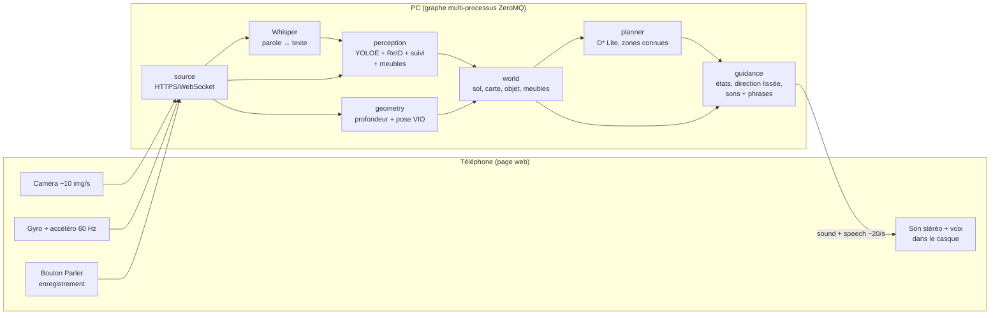

# VisionAId — Dossier technique (v2, avec les maths)

> Aide à la localisation d'objets pour les personnes aveugles et malvoyantes : vision, 3D, son et voix.
> Hackathon Hack1robo, Bordeaux, 21-22 novembre 2026.
> Équipe : Sarah Husson, Clément Poisson, Romain (design sonore), Corinne Bergès.
> Code : `github.com/SonDePoisson/VisionAid`. État : 22/11/2026 12h30, après la phase 29 et le mode démo.

**Comment lire ce document**
- Partie A : architecture et choix (10 min de lecture).
- Partie B : **les maths, bloc par bloc**, expliquées simplement, avec les formules et les valeurs réelles du code.
- Partie C : **questions probables du jury technique**, avec des réponses courtes.
- Partie D : **chaque technique expliquée en français** (réseaux de neurones, géométrie, capteurs, cartographie, son, voix, réseau), même les plus complexes.

---

# PARTIE A — Architecture et choix

## A0. En bref

- **Besoin** : « je cherche ma gourde » → le système trouve l'objet, le place dans une carte 3D de la pièce, calcule un chemin par les zones déjà vues, et guide **au son**, avec quelques **phrases** courtes.
- **Principe** : le **téléphone**, porté sur le torse, filme, mesure ses rotations, écoute la demande et joue le son. Le **PC** calcule tout le reste.
- **État** : chaîne complète en direct sur **Mac M4 + iPhone 12**. Testée aussi sur **PC Windows 8 Go sans GPU + Samsung Android** (voir A6).
- **Règle d'or** : **aucun LLM dans la boucle**. Tout est déterministe, mesurable, testé ; la sécurité ne dépend pas d'un texte généré.

## A1. Schéma

## A2. Le mur de post-its, aujourd'hui

| Post-it | Module | État |
|---|---|---|
| Téléphone, flux vidéo, transmission | `phone/` | ✅ iPhone et Android |
| Temps réel | `bus/`, `apps/run_live.py` | ✅ mesuré |
| Détection objet | `perception/` | ✅ + meubles (phase 29) |
| Profondeur | `perception/depth.py` | ✅ |
| Gyroscope | `pose/` | ✅ |
| Fusion 3D | `mapping/` | ✅ + repères (meubles) |
| Chemin | `planning/` | ✅ zones connues seulement (phase 28) |
| Guidage | `guidance/` | ✅ direction continue (phase 28) |
| Son | `audio/director.py`, `web/audio.js` | ✅ nouveaux sons de Romain, pan stéréo, couches |
| **Intervention vocale** | `phone/stt.py`, `guidance/narration.py` | ✅ **nouveau** (phase 29) |
| Option mémoire | états `remembered`, carte gardée au changement de cible | 🟡 partiel |
| Exploration, aide lecture, visage | — | ❌ |

## A3. Les choix structurants

| Choix | Pourquoi | Écarté |
|---|---|---|
| Page web servie par le PC | Rien à installer ; iPhone + Android ; on recharge pour mettre à jour | Flutter, appli native (ARKit gardé en réserve) |
| WebSocket + JPEG + acquittement | Images et capteurs datés sur **la même horloge** ; aucun retard cumulé | WebRTC (négociation fragile, horodatage indirect) |
| Calcul sur le PC | Modèles trop lourds pour un téléphone aujourd'hui | Tout embarqué |
| YOLOE (vocabulaire ouvert) + DINOv2 + couleur | Nouvel objet sans réentraînement ; « **ma** gourde », pas une bouteille | YOLO COCO (pas de classe « gourde ») |
| Profondeur monoculaire métrique | Pas de LiDAR sur les téléphones visés | LiDAR / ARKit (piste) |
| VIO « par composition » | Rapide à valider ; l'accéléromètre ne sert qu'à la verticale | Filtre de Kalman complet (EKF/MSCKF) |
| Carte log-odds + D* Lite | Carte qui change sans cesse ; replanification incrémentale en ms | Recalcul complet |
| **Chemin par zones connues seulement** | Ne jamais guider dans une zone jamais vue | Inconnu « pénalisé » (passait encore par là) |
| Machine à états + simulateur | Consignes stables, validées sur 100 essais par scénario | Réglages à l'œil |
| **Son stéréo à puissance constante** | Gauche/droite très lisible, mêmes réglages en direct et en vidéo | HRTF générique (abandonné, voir B9) |
| **Voix : 4 moments seulement** | Le son guide, la voix informe ; pas de bavardage | Narration continue |
| Phrase → cible sans LLM | Rapide, prévisible, vérifiable | Agent LLM |
| Tout open source, gratuit, local | Pas de coût, pas de données dans le cloud | API payantes |

## A4. Nouveautés de la nuit du 21 au 22 (phases 28-29 + sons)

1. **Nouveaux sons (Romain)**, en **couches superposées** :
   - **chemin** (son 2) : note répétée, placée à gauche/droite par un **pan stéréo** ; tempo qui accélère sous 2 m ;
   - **obstacles** (son 1) : nappe en boucle, **volume selon la distance**, superposée au chemin (le chemin continue pendant une alerte) ;
   - **arrivée** (son 3), une fois ; **recherche** (son 4) quand l'objet n'est pas encore trouvé ;
   - repérage perdu : nappe d'obstacles à volume moyen = « arrête-toi ».
2. **Cible probable plus prudente** : elle doit aussi avoir **la couleur de la cible** (un thermos noir avait été pris pour la gourde pendant 5 s).
3. **Phase 28** :
   - **chemins uniquement par des cases vues libres** ; si aucun chemin connu n'existe, on va **jusqu'à la frontière** de la zone connue (la carte s'étend en avançant) ;
   - **direction du son continue** : lissée dans le repère monde (0,3 s, au plus 90°/s), donc un changement de chemin **glisse** au lieu de sauter d'une oreille à l'autre, mais **une rotation du corps est rendue tout de suite**. Exception de sécurité : si la direction lissée mène vers un obstacle à moins de 1,5 m, on prend la nouvelle direction immédiatement.
4. **Phase 29 : la voix**
   - **Demande** : bouton **Parler** → le téléphone enregistre (arrêt après 0,9 s de silence) → **Whisper-small** transcrit sur le PC (~0,6 s sur Mac) → la phrase est associée à une fiche cible **sans LLM**. « Stop », « j'ai trouvé » arrêtent.
   - **Annonces** dites par le téléphone (`speechSynthesis`), à **4 moments** : demande comprise ; objet trouvé (où + trajet) ; approche ; correction si la cible probable était ailleurs.
   - **Meubles** (table, canapé, chaise…) détectés **dans la même passe YOLOE** que la cible, remontés en 3D et cartographiés → phrases du type « sur la table, derrière le canapé ».
   - **Changement de cible en direct** : ~10 ms (tout est préparé au démarrage).
5. **État de l'art** sur le guidage sonore (`docs/etat_de_lart_guidage_sonore.md`) : études, produits, pistes.
6. **Mode démo** (`--demo`, 22/11 10h40) : une seule bouteille dans la pièce, donc toute bouteille détectée est la cible (ni photos ni couleur). La règle « cible probable » s'applique désormais au **score lissé** de la piste : de loin, le score image par image oscillait autour du seuil et la règle des « 5 images d'affilée » repartait sans cesse de zéro.

## A5. Performances mesurées

| Mesure | Mac M4 + iPhone / faux téléphone | PC Windows 8 Go CPU + Samsung |
|---|---|---|
| Images reçues | ~10 img/s | ~10 img/s (limitées à 3) |
| IMU | 60 Hz | 60 Hz |
| Âge des images (p50) | ~40 ms | 35-46 ms |
| Chemins valides | 4,1 Hz | 0,52 Hz |
| Latence capture → chemin (p50 / p95) | 336 / 415 ms | 2,2 / 2,9 s |
| Whisper-small (une phrase) | ~0,6 s | à mesurer |
| Simulateur (succès, 100 essais) | pièce 96 %, apparition 95 %, couloir 89 % | — |

## A6. Portabilité Windows + Android (retour d'expérience)

| Problème | Cause | Réglage local | Correction durable |
|---|---|---|---|
| « mes clés » non reconnu | lecture des fichiers en cp1252 | `PYTHONUTF8=1` | `encoding="utf-8"` |
| Objet jamais placé sur la carte | tolérance détection ↔ profondeur = ±3 images en dur | `phone.max_fps: 3` | tolérance en secondes |
| Chemins toujours invalides | pose « périmée » au-delà de 1,5 s | `stale_s = 6` | `stale_s` dans la config |
| Gravité inversée sur Android | calibration iPhone (`accel_sign = −1`) appliquée à tous | `phone.device: samsung` | calibration par appareil |
| Téléchargement bloqué | protocole Xet de Hugging Face | `HF_HUB_DISABLE_XET=1` | — |
| Whisper sous Windows | décodage audio via **ffmpeg**, absent par défaut | installer ffmpeg | à documenter |
| Voix en rejeu / vidéo | utilise `say` (macOS seulement) | sans objet en direct (voix du téléphone) | moteur multiplateforme |

---

# PARTIE B — Les maths, bloc par bloc

Notations : vecteurs en gras quand c'est utile, **R** = rotation 3×3, **t** = translation, **K** = matrice de la caméra. Mètres, secondes, radians.

## B1. La caméra : modèle sténopé (« pinhole »)

**Idée** : un point 3D se projette sur l'image le long d'une droite qui passe par le centre optique.

- **Projection** d'un point caméra (X, Y, Z) vers le pixel (u, v) :
  `u = fx · X/Z + cx`, `v = fy · Y/Z + cy`, soit **K** = [[fx, 0, cx], [0, fy, cy], [0, 0, 1]].
- **Focale depuis le champ de vision** : `fx = (W/2) / tan(HFOV/2)`. Exemple : W = 640 px, HFOV = 69° → fx ≈ 466 px.
- **Rétroprojection** (pixel + profondeur Z → point 3D), le cœur de la fusion 3D :
  `X = (u − cx)·Z/fx`, `Y = (v − cy)·Z/fy`.
- **Changement de repère** : `p_monde = T_world_cam · [p_cam, 1]`, avec `T = [[R, t], [0, 1]]` (matrice 4×4).
- **Calibration au damier** (phase 17) : on photographie un damier de taille connue sous 15-20 angles ; OpenCV cherche K et la distorsion qui **minimisent l'erreur de reprojection** (écart en pixels entre coins vus et coins prédits). Objectif : < 0,5 px.

## B2. Détection et reconnaissance de l'objet

**YOLOE (vocabulaire ouvert)**
- Le texte (« water bottle ») est transformé en **vecteur** par un encodeur texte (MobileCLIP) ; chaque région de l'image a aussi un vecteur ; le score d'une classe ≈ **similarité** entre les deux, passée dans une sigmoïde.
- Score **indépendant par classe** + suppression des doublons **par classe** → ajouter « table », « canapé » au vocabulaire **ne change pas** les détections de la cible (vérifié « au bit près »).

**Ré-identification (ReID) : est-ce MA gourde ?**
- **DINOv2** transforme chaque détection en vecteur **e** (empreinte visuelle, apprise sans étiquettes).
- **Similarité cosinus** avec les photos de référence :
  `s = max_k (e · e_k) / (‖e‖ ‖e_k‖)`, entre −1 et 1 (1 = identique).
- **Score couleur** `c` ∈ [0, 1] : proportion de pixels dans les plages de teinte de l'objet (HSV), par ex. orange = H ∈ [5°, 30°], S ≥ 150, V ≥ 100.
- **Score final multiplicatif (moyenne géométrique pondérée)** :
  `score = s^0,6 · c^0,4`.
  - Pourquoi pas `0,6·s + 0,4·c` ? Avec une somme, une gourde **bleue** (forme parfaite, couleur fausse) passait. Avec un produit, **c ≈ 0 annule le score**.
- **Seuil** 0,575, choisi pour **maximiser le F1** sur des positifs (augmentations) et des négatifs réels :
  `F1 = 2·P·R / (P + R)`, P = précision, R = rappel. Résultat : rappel 98 %, **0 faux positif sur 607**.
- **Cible probable** : score ≥ 0,85 × seuil (≈ 0,49) pendant **5 images de suite**, **et** part couleur lissée ≥ 0,7.

**Suivi (tracker)**
- Association détection ↔ piste par **IoU** (aire de l'intersection / aire de l'union des boîtes).
- **Hystérésis** : il faut plusieurs images pour confirmer, et une piste confirmée ne peut pas « sauter » sur une détection au score < 0,6 × seuil (bug de la boîte de céréales corrigé).

## B3. Profondeur monoculaire

- **Depth Anything V2 Metric Indoor Small** : un *Vision Transformer* (ViT-S, ~25 M de paramètres) + une tête de régression (DPT) affinée sur des scènes d'intérieur ; il sort une **profondeur en mètres** par pixel, à partir d'une seule image.
- **Pourquoi c'est imparfait** : une seule image ne contient pas l'échelle ; le réseau la **devine** d'après le contenu (taille typique d'une table…). D'où un **biais d'échelle** et un bruit qui croît avec la distance → recalage par la hauteur de caméra (B5) et obstacles marqués seulement jusqu'à 3 m (B6).
- **Coût** : ~130 ms par image à 518 px sur GPU, ~2 s sur CPU ; 364 px divise le temps par ~1,6 mais dégrade la précision.

## B4. Pose : odométrie visuelle + gyroscope + gravité (VIO)

**B4.1 Odométrie visuelle RGB-D**
- Points d'intérêt **ORB** dans l'image clé et l'image courante → appariements.
- Les points de l'image clé ont une profondeur → ce sont des points **3D**. On cherche la pose (**R**, **t**) de la caméra courante qui les **reprojette** au mieux sur leurs pixels observés :
  `min Σ ρ( ‖u_i − π(K (R·X_i + t))‖² )`, avec ρ = perte de **Huber** (réduit l'influence des erreurs).
  C'est le problème **PnP** (*Perspective-n-Point*).
- **AP3P** : solution exacte à partir de **3 points** seulement.
- **RANSAC** : on tire 3 points au hasard, on calcule une pose, on compte les points d'accord (*inliers*) ; on garde la meilleure. Nombre de tirages pour réussir avec probabilité p quand une fraction w des appariements est bonne :
  `N = log(1 − p) / log(1 − w³)`. Exemple : p = 0,99, w = 0,5 → N ≈ 35.
- Raffinement **Levenberg-Marquardt**, puis raffinement **symétrique** (dans les deux sens).

**B4.2 Le gyroscope prédit la rotation**
- Le gyroscope mesure la vitesse angulaire **ω** (rad/s). Entre deux images :
  `R_{k+1} = R_k · exp([ω·Δt]×)`, où `exp([θ]×)` est la **formule de Rodrigues** :
  `exp([θ]×) = I + sin‖θ‖·[n]× + (1 − cos‖θ‖)·[n]ײ`, avec n = θ/‖θ‖ et `[n]×` la matrice du produit vectoriel.
- Utilisations : graine du PnP, **contrôle de cohérence** (écart > 8° → on se méfie de la vision), et **repli** (état `degraded`, 2 s max) si la vision décroche.

**B4.3 L'accéléromètre donne la verticale (filtre complémentaire)**
- Au repos, l'accéléromètre ne « sent » pas la chute mais la **réaction du support** : un vecteur de 9,81 m/s² **dirigé vers le haut**. Sa direction donne donc « le haut ».
- Filtre complémentaire, gain k = 0,05 :
  `û ← normaliser( (1 − k)·û_prédit + k·â_mesuré )`.
  Le gyroscope assure la **réactivité** (court terme), l'accéléromètre la **justesse** (long terme, sans dérive).
- Mesure ignorée si `| ‖a‖ − 9,81 | > 1,5 m/s²` (on accélère : ce n'est plus la gravité).
- **Pourquoi pas la position par l'accéléromètre** : il faudrait intégrer deux fois ; un biais b donne une erreur `½·b·t²` → avec b = 0,05 m/s², **2,5 cm après 1 s, 2,5 m après 10 s**.

**B4.4 Calibration gyroscope ↔ caméra** (phase 17)
- **Décalage temporel δ** : on corrèle la norme ‖ω_gyro(t + δ)‖ avec la norme de la vitesse de rotation **visuelle** ; on garde le δ qui maximise la corrélation (recherche sur ±300 ms, pas de 0,5 ms). La norme ne dépend pas de l'orientation des axes : on peut trouver δ **avant** la rotation.
- **Rotation entre les repères `R_cam_imu`** par l'algorithme de **Kabsch** : on aligne les vecteurs de rotation gyroscope **a_i** et visuels **b_i** :
  `H = Σ a_i·b_iᵀ`, décomposition `H = U·Σ·Vᵀ`, puis `R = V·diag(1, 1, det(V·Uᵀ))·Uᵀ` (le `det` évite une symétrie miroir).
- Résultat réel : Safari iOS envoie les axes du gyroscope **dans un autre ordre que la norme** (rotation trouvée de 119° = permutation cyclique des axes) et l'accéléromètre **avec le signe inversé**.

## B5. Le sol et l'échelle

- **Plan du sol** : `n · p + d = 0`. RANSAC sur les points 3D bas ; quand la gravité est connue, **n est imposé** (vertical) et seul d est estimé.
- **Hauteur de caméra mesurée** = distance du centre optique au plan = `|d|` (si ‖n‖ = 1).
- **Facteur d'échelle** : `s = h_déclarée / h_mesurée`, appliqué à toute la profondeur.
- **Lissage en logarithme** (une erreur de ×2 et de ÷2 pèsent pareil) :
  `log s_t = (1 − α)·log s_{t−1} + α·log s_mesure`, α = 0,1, et `s ∈ [0,5 ; 2]`.

## B6. La carte (costmap) : log-odds et lancer de rayons

- Grille de **5 cm**. Chaque case garde une « croyance » d'occupation en **log-odds** :
  `L = log( p / (1 − p) )`, donc `p = 1 / (1 + e^(−L))`.
- **Pourquoi** : la règle de Bayes devient une **simple addition** :
  - case au bout d'un rayon (obstacle vu) : `L ← L + 0,85` ;
  - case traversée par un rayon (vue libre) : `L ← L − 0,4` ;
  - occupée si p > 0,6, libre si p < 0,35, sinon inconnue.
- **Lancer de rayons** (type Bresenham) : de la caméra à chaque point 3D projeté au sol.
- **Hauteurs** : un point compte comme obstacle s'il est entre 0,10 m et 1,90 m au-dessus du sol (+4 cm de tolérance par mètre de distance, car le bruit croît avec la distance).
- **Oubli** : demi-vie de 20 s, `L ← L · 2^(−Δt / 20)`.
- **Portée** : obstacles marqués seulement jusqu'à **3 m** ; au-delà, la profondeur fait « remonter » le sol lointain, qui fermait tous les passages.
- **Gonflage** : par **transformée de distance**, on calcule pour chaque case sa distance au plus proche obstacle ; une case à moins de **0,35 m** (demi-largeur du corps + marge) est infranchissable.

## B7. Le chemin : A* et D* Lite

- Graphe = cases franchissables, voisins à 8 directions, **coût d'un pas** :
  `longueur × (1 + moyenne des coûts des deux cases)` (on préfère s'éloigner des obstacles).
- **A\*** : explore en priorité les cases au plus petit `f = g + h`, où g = coût depuis le départ, h = estimation jusqu'au but (distance « octile », **jamais surestimée** → chemin optimal garanti).
- **D\* Lite** : même résultat, mais **incrémental** ; chaque case garde g et `rhs` (sa meilleure valeur « d'après les voisins »). Quand la carte change, seules les cases incohérentes (g ≠ rhs) sont recalculées → **1,9 ms** au lieu de plusieurs secondes.
- **Numba** compile ces boucles Python en code machine (A* : 38 ms → 2,9 ms).
- **Règles métier** :
  - **phase 28 : seulement des cases vues libres**. Sinon, **chemin jusqu'à la frontière** de la zone connue ;
  - **but « à portée de main »** : une case à moins de 0,55 m de l'objet, du côté **le moins coûteux pour l'utilisateur** (un seul Dijkstra) ;
  - **engagement** : on garde l'ancien chemin s'il reste praticable et n'est pas plus long que le nouveau de plus de 20 % + 30 cm → pas de zigzag ;
  - **chien de garde** : pose trop ancienne → chemin publié **invalide**.

## B8. Le guidage : machine à états et direction continue

**Machine à états** (priorités) :
`TRACKING_LOST > OBSTACLE_ALERT > ARRIVED > APPROACHING > NAVIGATING > SEARCHING`.
- Seuils : approche 1,2 m, arrivée 0,5 m, obstacle 0,6 m **dans le couloir du corps** (±0,25 m de part et d'autre).
- **Hystérésis** : on sort d'un état à **seuil + 0,15 m** (pas de clignotement à la frontière).
- **Temps de maintien** minimal : 0,3 s entre deux changements.

**Direction vers où aller** (azimut, positif à gauche)
- Point de visée sur le chemin, en **ligne de vue** depuis l'utilisateur.
- `az = atan2(y_tête, x_tête)` dans le repère de la tête (= torse).
- **Lissage dans le repère monde** (phase 28) : on lisse θ_monde (filtre du 1er ordre, τ = 0,3 s), avec un **taux maximal de 90°/s**, puis on revient à la tête : `az = θ_monde_lissé − cap_du_corps`.
  - Un **changement de chemin** glisse (au plus 90°/s) ;
  - une **rotation du corps** est rendue **immédiatement** (elle passe par le cap, pas par le lissage) ;
  - **sécurité** : si la direction lissée vise un obstacle à < 1,5 m et la nouvelle est dégagée, on saute directement.
- Le filtre du 1er ordre, pas à pas : `θ ← θ + (1 − e^(−Δt/τ)) · wrap(θ_cible − θ)`, où `wrap` ramène l'écart dans ]−π, π] (on tourne toujours par le plus court).

**Simulateur** : agent virtuel (réaction 0,3 s, erreur de cap σ = 10°, 0,6 m/s) sur 100 cartes aléatoires par scénario → mesure du succès et des collisions ; c'est ce qui a permis de régler les règles ci-dessus.

## B9. Le son

**Loi de pan stéréo à puissance constante** (`audio/director.py`)
- `pan = −az / 90°`, borné à [−1, 1] (−1 = tout à gauche, +1 = tout à droite).
- Gains : `θ = (pan + 1)·π/4`, `G_gauche = cos θ`, `G_droite = sin θ`.
- **Pourquoi « puissance constante »** : `G_g² + G_d² = 1` → le volume **perçu** reste le même quand le son se déplace (au centre : 0,707 / 0,707, soit −3 dB par oreille, et non pas un « trou » de −6 dB).
- **Derrière** (|az| > 90°) : tout d'un côté, celui du **demi-tour le plus court**, avec une hystérésis à 150° (pas de bascule gauche/droite quand le chemin est pile derrière).

**Pourquoi le stéréo plutôt que le HRTF** (changement de la nuit)
- Le HRTF générique imite les oreilles d'un « mannequin » : avant/arrière et élévation souvent confondus (~17 % de confusions avant/arrière avec la tête KEMAR, d'après l'état de l'art de l'équipe).
- La littérature montre que **le suivi des mouvements de tête** compte plus qu'un HRTF ; or le téléphone est sur le torse.
- Le pan stéréo est **simple, net et identique** en direct et en vidéo. Le « derrière » est codé autrement : demi-tour par le plus court.
- Pour mémoire, la version précédente (binaural paramétrique) utilisait la formule de **Woodworth** pour l'écart de temps entre les oreilles : `ITD = (a/c)·(θ + sin θ)`, avec a ≈ 8,75 cm (rayon de la tête) et c = 343 m/s → **0,66 ms** au maximum (son à 90°).

**Tempo du chemin** : une note toutes les 1,2 s au loin ; sous 2 m, l'intervalle diminue **linéairement** jusqu'à 0,35 s à 0,5 m.
`intervalle(d) = 0,35 + (1,2 − 0,35) · (d − 0,5) / (2 − 0,5)`, borné.

**Volume des obstacles** (en dB, donc perçu linéairement) :
- muet au-delà de 1,5 m ; de −24 dB à 1,5 m jusqu'à −6 dB à 0,4 m ;
- rappel : `gain = 10^(dB/20)` → −6 dB ≈ ×0,5, −24 dB ≈ ×0,06 ;
- lissé sur 0,3 s ; jamais plus fort que le chemin.

**Égalisation** : tous les sons sont ramenés à **−20 LUFS** (sonie perçue normalisée, norme EBU R128).

**Chien de garde** : sans consigne depuis 1,5 s, le téléphone joue « repérage perdu ».

## B10. La voix

**Reconnaissance (STT) : Whisper-small**
- Modèle **encodeur-décodeur Transformer** (~244 M de paramètres), entraîné sur 680 000 h d'audio multilingue.
- Le son est transformé en **spectrogramme log-Mel** (80 bandes de fréquence, fenêtres de 25 ms tous les 10 ms) ; l'encodeur en fait une représentation, le décodeur génère le texte mot à mot.
- Langue forcée au français ; ~0,6 s par phrase sur Mac.
- **Micro coupé dès la fin de la demande** : un casque Bluetooth qui garde le micro passe en profil « mains libres » (mono, 16 kHz), ce qui casserait la stéréo.

**De la phrase à la cible, sans LLM**
- Normalisation : minuscules, accents, ponctuation ; retrait des mots vides (« où », « est », « ma »…) ; singulier approché.
- Égalité exacte avec une phrase de fiche, sinon **inclusion** ; zéro ou plusieurs correspondances → message qui liste les cibles connues.

**Annonces (TTS)** : `speechSynthesis` du téléphone, à 4 moments seulement.
- **Positions égocentriques** d'après l'azimut : |az| ≤ 20° « devant toi » ; ≤ 60° « un peu sur ta gauche/droite » ; ≤ 120° « sur ta gauche/droite » ; ≤ 160° « derrière toi, sur ta… » ; au-delà « derrière toi ». « Au fond » au-delà de 3 m.
- **Distances** arrondies au mètre ; « tout près » sous 1,2 m.
- **Hauteurs** : < 0,3 m « par terre », < 0,6 m « à hauteur des genoux », < 1,2 m « à hauteur de taille », sinon « en hauteur ».

**Meubles (repères)**
- Masque de segmentation **érodé** (on retire le bord, où la profondeur est fausse) → points 3D → **boîte au sol** par meuble ; fusion des observations par famille (table / bureau / table basse…) ; annoncé après **3 observations**.
- « **Sur** la table » : l'objet est dans l'emprise du meuble et le dessus est juste sous lui.
- « **Derrière** le canapé » : le segment utilisateur → objet coupe un meuble d'au moins 0,15 m² ; le côté de contournement est lu sur le chemin.

## B11. Temps réel et mesures

- **Synchronisation d'horloge** (ping/pong) : `offset = t_pc − (t_phone + RTT/2)`, en gardant l'échange au **RTT minimal** sur une fenêtre glissante (le moins perturbé).
- **Latence de bout en bout** = instant de publication du chemin − (instant de prise de vue + offset).
- **Conflation** (ZeroMQ) : chaque nœud ne lit que le **dernier** message → un nœud lent saute des images mais **n'accumule jamais de retard**.
- **Contre-pression** : le téléphone n'envoie une image qu'après l'acquittement de la précédente.
- **p50 / p95** : médiane / valeur sous laquelle se trouvent 95 % des mesures (on regarde p95 pour les « mauvais moments »).

---

# PARTIE C — Questions probables du jury technique

**Q1. Pourquoi ne pas tout faire sur le téléphone ?**
Les modèles (détection + profondeur + ReID) demandent un GPU pour tenir 4 Hz. Le découpage téléphone-capteur / PC-calcul permet de prototyper vite ; l'étape suivante est de faire tourner le son localement (boucle rapide), puis d'embarquer des modèles quantifiés.

**Q2. Pourquoi pas de LLM ?**
Latence, coût, et surtout **sécurité et prévisibilité** : on guide une personne qui ne voit pas. Chaque décision est une règle mesurable et testée (≈ 200 tests, simulateur sur 100 cartes).

**Q3. Comment distinguez-vous « ma » gourde d'une autre bouteille ?**
Détection ouverte par le texte, puis **ReID** : similarité DINOv2 avec des photos de référence × score couleur, en **produit** (`s^0,6·c^0,4`). Seuil calibré au F1 : 98 % de rappel, 0 faux positif sur 607 négatifs.

**Q4. Une seule caméra, comment avez-vous la 3D et l'échelle ?**
Profondeur métrique par réseau (Depth Anything V2), puis **recalage d'échelle** par la hauteur de caméra déclarée et le plan du sol (orienté par la gravité). Limites : bruit au-delà de 3 m, d'où la portée limitée des obstacles.

**Q5. Pourquoi pas un filtre de Kalman ?**
Un EKF complet est long à régler et à valider sans vérité terrain. Notre VIO « par composition » utilise chaque capteur pour ce qu'il fait de mieux : vision = position, gyroscope = rotation rapide, accéléromètre = verticale. En rotation rapide avec flou : 0 % de pertes contre 55 % pour la vision seule.

**Q6. Que se passe-t-il si la vision décroche ?**
État `degraded` : orientation au gyroscope, position gelée, 2 s maximum ; ensuite `lost`, chemin invalide, son « arrête-toi ». Le système préfère se taire que guider faux.

**Q7. Pourquoi le chemin ne passe-t-il que par des zones vues ?**
Une zone jamais vue peut cacher un obstacle. Si aucun chemin connu n'existe, on guide jusqu'à la frontière : en avançant, la caméra découvre la suite.

**Q8. Pourquoi D* Lite plutôt qu'A* ?**
La carte change à chaque image ; D* Lite ne recalcule que ce qui a changé : 1,9 ms en incrémental.

**Q9. Pourquoi un pan stéréo et pas un vrai son 3D (HRTF) ?**
Le HRTF générique confond souvent l'avant et l'arrière, et le vrai remède est le suivi de tête, que nous n'avons pas (téléphone sur le torse). Le stéréo à puissance constante est net et constant en volume ; « derrière » est codé par le côté du demi-tour le plus court.

**Q10. Comment évitez-vous que le son saute d'une oreille à l'autre ?**
Direction lissée **dans le repère monde** (τ = 0,3 s, ≤ 90°/s), puis ramenée à la tête : les changements de chemin glissent, mais les rotations du corps sont rendues tout de suite. Exception si la direction lissée mène vers un obstacle proche.

**Q11. Quelle est la latence, et est-ce suffisant ?**
Sur Mac : p50 336 ms, p95 415 ms de la prise de vue au chemin. Suffisant pour retrouver un objet à pied lent. Sur un PC sans GPU : ~2,2 s → mode « arrêt-marche ». Ce n'est **pas** un outil d'évitement d'obstacles : la canne reste indispensable.

**Q12. Comment avez-vous validé sans utilisateurs aveugles ?**
Simulateur (agent avec temps de réaction et erreur de cap, 100 essais par scénario), sessions réelles rejouées, tests automatiques, et écoute au casque. Les tests avec des personnes aveugles sont la prochaine étape.

**Q13. Que se passe-t-il pour la vie privée ?**
Tout est local : aucune image ne part dans le cloud. Les sessions restent sur la machine (hors git). Pas de reconnaissance de visage.

**Q14. Le système marche-t-il sur du matériel modeste ?**
Oui, testé sur PC Windows 8 Go sans GPU + Samsung Android : chaîne complète, 190 chemins valides, son gauche/droite correct, latence ~2,2 s. Trois réglages de timing ont été nécessaires (voir A6).

**Q15. Industrialisation : quelles étapes ?**
1. Boucle rapide sur le téléphone (orientation du son par son propre gyroscope). 2. Pose ARKit/ARCore et LiDAR quand disponible. 3. Modèles quantifiés embarqués. 4. Tests avec des associations de personnes aveugles et malvoyantes. 5. Enregistrement de « mes objets » par un proche, en quelques photos.

---

# PARTIE D — Les techniques expliquées en français

Chaque technique est présentée en trois temps : **l'idée en une phrase**, **comment ça marche**, **pourquoi on l'utilise ici**. Certaines explications sont exigeantes : c'est le niveau attendu face à un jury technique.

## D1. Réseaux de neurones : les briques de base

**Réseau de neurones**
- *Idée* : une très grande fonction mathématique, avec des millions de paramètres réglables, qui apprend à transformer une entrée (image, son) en une sortie utile (boîtes, profondeur, texte).
- *Comment* : des couches successives font des multiplications de matrices suivies de fonctions non linéaires. L'**apprentissage** ajuste les paramètres pour réduire une erreur mesurée sur des millions d'exemples : on calcule dans quel sens chaque paramètre doit bouger (le **gradient**, par **rétropropagation**), puis on le déplace un peu (**descente de gradient**).
- *Ici* : on n'entraîne aucun réseau. On utilise des réseaux **pré-entraînés**, téléchargés une fois, en **inférence** seulement (on leur donne une entrée, ils donnent une sortie).

**Réseau convolutif (CNN)**
- *Idée* : un réseau spécialisé dans les images, qui fait glisser de petits filtres sur l'image.
- *Comment* : chaque filtre (3×3 pixels, par exemple) détecte un motif local : bord, coin, texture. En empilant les couches, on passe des motifs simples aux parties d'objets, puis aux objets entiers.
- *Ici* : la partie « vision » de YOLOE.

**Transformer et attention**
- *Idée* : un réseau qui, pour chaque élément (un morceau d'image, un mot, un instant de son), regarde **tous les autres** et décide lesquels sont importants pour lui.
- *Comment* : chaque élément produit trois vecteurs : une **requête** (ce que je cherche), une **clé** (ce que je contiens) et une **valeur** (ce que je transmets). Le poids de l'attention entre deux éléments est le produit scalaire requête · clé, normalisé par un *softmax* (pour que les poids soient positifs et somment à 1). La sortie est la moyenne des valeurs, pondérée par ces poids :
  `Attention(Q, K, V) = softmax(Q·Kᵀ / √d) · V` (le `√d` évite des valeurs trop grandes).
- *Ici* : DINOv2, Depth Anything et Whisper sont des Transformers.

**Vision Transformer (ViT)**
- *Idée* : appliquer un Transformer à une image en la découpant en **petits carrés** (14×14 pixels), traités comme des « mots ».
- *Ici* : DINOv2 et Depth Anything V2 sont des ViT. Leur force est la vue d'ensemble de l'image, utile pour estimer une distance d'après le contexte de la pièce.

**Plongement (embedding)**
- *Idée* : résumer un objet complexe (une image, une phrase) par un **vecteur** de quelques centaines de nombres, de sorte que deux choses semblables aient des vecteurs proches.
- *Ici* : la ReID compare des plongements DINOv2 ; YOLOE compare des plongements d'image et de texte.

## D2. Détection et reconnaissance

**Détection d'objets (YOLO)**
- *Idée* : en un seul passage sur l'image (« You Only Look Once »), trouver toutes les boîtes qui entourent des objets, avec leur classe et un score de confiance.
- *Comment* : l'image est découpée en une grille ; pour chaque zone, le réseau prédit des boîtes candidates et des scores. On garde ensuite les meilleures.
- *Ici* : rapide (dizaines d'images/s sur GPU), et la version « seg » donne en plus le **masque** (les pixels exacts de l'objet), utile pour mesurer sa profondeur sans prendre le fond.

**Vocabulaire ouvert (YOLOE, apprentissage contrastif type CLIP)**
- *Idée* : au lieu d'une liste figée de classes, on **décrit en mots** ce qu'on cherche.
- *Comment* : un modèle comme CLIP a été entraîné sur des millions de paires image-légende à **rapprocher** les plongements d'une image et de sa légende, et à **éloigner** ceux des paires qui ne vont pas ensemble (apprentissage **contrastif**). YOLOE compare le plongement de chaque région de l'image avec celui du texte demandé.
- *Ici* : « gourde », « clés », « table » sans réentraîner quoi que ce soit.

**Suppression des non-maxima (NMS)**
- *Idée* : le détecteur propose souvent plusieurs boîtes sur le même objet ; on n'en garde qu'une.
- *Comment* : on trie les boîtes par score ; on garde la meilleure, on supprime celles qui la chevauchent trop (IoU élevé), et on recommence.
- *Ici* : appliquée **classe par classe**, c'est pourquoi ajouter les meubles ne modifie pas les détections de la gourde.

**IoU (Intersection sur Union)**
- *Idée* : mesurer à quel point deux boîtes se recouvrent.
- *Comment* : aire commune ÷ aire totale couverte par les deux. 1 = identiques, 0 = disjointes.
- *Ici* : NMS, et association des détections aux pistes d'une image à l'autre.

**Apprentissage auto-supervisé (DINOv2)**
- *Idée* : apprendre à « bien voir » sans étiquettes humaines.
- *Comment* : un réseau « élève » voit des morceaux déformés d'une image et doit produire la même représentation qu'un réseau « professeur » qui voit l'image entière. Pour y arriver, il doit comprendre la forme et la matière des objets, pas seulement leurs étiquettes.
- *Ici* : ses plongements distinguent très bien **deux objets de la même catégorie** (ma gourde contre une autre bouteille).

**Similarité cosinus**
- *Idée* : comparer deux vecteurs par l'**angle** entre eux, pas par leur longueur.
- *Comment* : cos(angle) = produit scalaire ÷ (produit des longueurs). 1 = même direction.
- *Ici* : score d'apparence de la ReID.

**Espace de couleur HSV**
- *Idée* : décrire une couleur par sa **teinte** (H : rouge, orange…), sa **saturation** (S : vive ou terne) et sa **valeur** (V : claire ou sombre).
- *Pourquoi pas RVB* : en RVB, une ombre change les trois valeurs ; en HSV, la teinte reste presque stable.
- *Ici* : « part d'orange » de la gourde, robuste à l'éclairage.

**Suivi (tracking) et lissage exponentiel (EMA)**
- *Idée* : relier les détections d'une image à l'autre pour suivre **le même objet** dans le temps, et lisser son score.
- *Comment* : moyenne mobile exponentielle `m ← (1 − α)·m + α·x` : chaque nouvelle mesure compte pour α, et le passé s'efface progressivement.
- *Ici* : confirmation de la cible et, depuis 10h40, règle de la « cible probable » appliquée au score lissé.

## D3. Profondeur à partir d'une seule image

**Estimation de profondeur monoculaire**
- *Idée* : deviner la distance de chaque pixel à partir d'une seule photo, comme un humain qui ferme un œil.
- *Comment* : le réseau a appris, sur de nombreuses images avec leur vraie profondeur, les **indices** de distance : taille habituelle des objets, perspective des lignes, texture qui devient plus fine au loin, objets qui en cachent d'autres.
- *Variante métrique* : « Metric Indoor » a été affiné sur des scènes d'intérieur pour donner directement des **mètres**.
- *Limite* : l'échelle est devinée → biais possible, corrigé par la hauteur de caméra.

**Tête DPT (Dense Prediction Transformer)**
- *Idée* : transformer la sortie d'un ViT (des carrés de 14 pixels) en une carte **pixel par pixel**.
- *Comment* : elle combine des couches à plusieurs niveaux de détail (assemblage multi-échelle) et agrandit progressivement l'image.

## D4. Géométrie de la vision

**Modèle sténopé et matrice K** : voir B1. C'est la « règle » qui relie un point 3D à son pixel.

**Distorsion**
- *Idée* : les objectifs réels courbent légèrement les lignes droites, surtout au bord de l'image.
- *Ici* : estimée à la calibration, mais pas encore corrigée (modèle sténopé simple).

**Points d'intérêt ORB**
- *Idée* : repérer dans l'image des points faciles à retrouver d'une image à l'autre (coins, détails contrastés).
- *Comment* : **FAST** trouve les coins (un pixel nettement plus clair ou plus sombre que ses voisins sur un cercle) ; **BRIEF** décrit chaque point par 256 comparaisons de luminosité entre paires de pixels voisins (un code binaire de 256 bits), orienté pour résister à la rotation.
- *Appariement* : on compare deux codes par la **distance de Hamming** (nombre de bits différents) ; le **test du rapport** de Lowe garde un appariement seulement s'il est nettement meilleur que le deuxième choix.
- *Ici* : rapide, gratuit, sans brevet, suffisant pour la VO.

**PnP (Perspective-n-Point)** : retrouver la position de la caméra à partir de points 3D connus et de leurs pixels (voir B4.1).

**RANSAC**
- *Idée* : estimer un modèle en présence de **mauvaises données**, en refusant de les écouter.
- *Comment* : on tire au hasard le minimum de données nécessaires (3 points pour une pose), on calcule un modèle, on compte combien d'autres données sont d'accord ; on garde le modèle qui met le plus de monde d'accord.
- *Ici* : pose (PnP) et plan du sol.

**Moindres carrés, Levenberg-Marquardt et perte de Huber**
- *Idée* : ajuster des paramètres pour que l'erreur totale (somme des carrés des écarts) soit la plus petite possible.
- *Levenberg-Marquardt* : méthode itérative qui hésite intelligemment entre de grands pas rapides (Gauss-Newton) et de petits pas prudents (descente de gradient).
- *Huber* : erreur au carré pour les petits écarts, linéaire pour les grands → une seule mauvaise mesure ne peut pas tout tirer.

**Images clés (keyframes)**
- *Idée* : ne pas comparer chaque image à la précédente (les petites erreurs s'accumulent), mais à une image de référence tant qu'on la voit bien.

**Odométrie visuelle et dérive**
- *Idée* : calculer son déplacement en enchaînant des petits déplacements estimés. Chaque petite erreur s'ajoute : la position **dérive** lentement.
- *Remède possible (non fait)* : reconnaître un lieu déjà vu et corriger la trajectoire (fermeture de boucle, optimisation de graphe de poses).

## D5. Capteurs inertiels et fusion

**Gyroscope et accéléromètre MEMS**
- *Idée* : de minuscules structures mécaniques gravées dans le silicium.
- *Gyroscope* : une masse vibrante dévie sous l'effet de la **force de Coriolis** quand le téléphone tourne → vitesse de rotation.
- *Accéléromètre* : une masse suspendue se déplace sous l'accélération → accélération, **gravité incluse**.
- *Défauts* : **biais** (valeur non nulle à l'arrêt), bruit, décalage temporel avec la caméra.

**Représenter une rotation** : matrice 3×3, vecteur de rotation (axe × angle), quaternion (4 nombres, sans blocage de cardan). La **formule de Rodrigues** (B4.2) passe d'un vecteur de rotation à une matrice.

**Filtre complémentaire**
- *Idée* : combiner un capteur **rapide mais qui dérive** (gyroscope) et un capteur **lent mais juste en moyenne** (accéléromètre).
- *Comment* : on suit le gyroscope à court terme, et on se rapproche doucement (5 % par mesure) de ce que dit l'accéléromètre. En fréquence : passe-haut sur l'un, passe-bas sur l'autre, d'où « complémentaire ».
- *Ici* : la verticale.

**Filtre de Kalman (non utilisé, à connaître)**
- *Idée* : version probabiliste et optimale du filtre complémentaire ; il garde une estimation **et son incertitude**, prédit avec un modèle, puis corrige avec les mesures en pondérant chacune selon sa fiabilité.
- *EKF / MSCKF* : versions pour les systèmes non linéaires et la vision-inertie. Écartés ici : trop longs à régler sans vérité terrain.

**Corrélation croisée**
- *Idée* : trouver le décalage dans le temps qui fait le mieux « coller » deux signaux.
- *Ici* : décalage gyroscope ↔ caméra (B4.4).

**Algorithme de Kabsch et SVD**
- *Idée* : trouver la rotation qui superpose au mieux deux nuages de vecteurs.
- *SVD (décomposition en valeurs singulières)* : toute matrice s'écrit U·Σ·Vᵀ (rotation, étirement, rotation) ; la meilleure rotation se lit directement dans U et V.
- *Ici* : orientation du gyroscope par rapport à la caméra.

**Synchronisation d'horloges (type NTP)**
- *Idée* : le téléphone et le PC n'ont pas la même heure ; on mesure l'écart en échangeant des messages horodatés.
- *Comment* : on suppose l'aller et le retour de même durée (RTT/2). On garde l'échange le plus rapide, le moins perturbé.

## D6. Cartographie et planification

**Plan du sol par RANSAC** : voir B5 ; la gravité fixe l'orientation, il ne reste qu'à trouver la hauteur.

**Grille d'occupation et log-odds**
- *Idée* : découper le sol en cases de 5 cm, et estimer pour chacune la probabilité qu'elle soit occupée.
- *Règle de Bayes* : on met à jour une croyance quand une nouvelle preuve arrive. En **log-odds**, la mise à jour devient une **addition** : simple, rapide, et sans débordement numérique.
- *Lancer de rayons (Bresenham)* : algorithme qui trace une droite case par case sur une grille, sans calcul à virgule.

**Transformée de distance**
- *Idée* : calculer en un passage, pour chaque case, la distance à l'obstacle le plus proche.
- *Ici* : « gonfler » les obstacles de la largeur du corps et préférer les chemins qui s'en éloignent.

**Dijkstra, A\*, D\* Lite**
- *Dijkstra* : explore depuis le départ par coût croissant ; trouve le chemin optimal vers **toutes** les cases. Utilisé pour choisir le point d'arrivée « à portée de main ».
- *A\** : Dijkstra guidé par une estimation de la distance restante (heuristique) ; si l'estimation ne surestime jamais, le chemin reste optimal, et on explore beaucoup moins.
- *D\* Lite* : A\* « qui se souvient ». Après un changement de carte, il ne corrige que les cases touchées. Conçu à l'origine pour les robots qui découvrent leur terrain en avançant.

**Frontière**
- *Idée* : la limite entre le connu et l'inconnu. Aller vers la frontière, c'est explorer.
- *Ici* : si aucun chemin connu n'atteint l'objet, on guide jusqu'à la frontière (phase 28).

**Compilation JIT (Numba)**
- *Idée* : Python est lent dans les boucles ; Numba **traduit en code machine**, au premier appel, les fonctions numériques marquées.
- *Ici* : A\* 13 fois plus rapide.

## D7. Guidage et simulation

**Machine à états finis**
- *Idée* : le système est toujours dans **un** état (recherche, navigation, approche…), avec des règles précises pour passer de l'un à l'autre.
- *Ici* : comportement prévisible et testable, priorités claires (sécurité d'abord).

**Hystérésis**
- *Idée* : un seuil pour entrer, un autre pour sortir, comme un thermostat. Sans elle, une mesure qui hésite autour du seuil fait clignoter l'état.

**Filtre passe-bas et limitation de vitesse**
- *Idée* : laisser passer les variations lentes et gommer les sauts brusques ; et interdire à la direction de tourner plus vite que 90°/s.
- *Subtilité* : on lisse dans le **repère monde**, pas dans le repère de la tête, pour ne pas retarder la réponse aux rotations du corps.

**Simulation Monte-Carlo**
- *Idée* : rejouer un grand nombre de scénarios tirés au hasard pour mesurer un taux de réussite.
- *Ici* : 100 pièces aléatoires par scénario, avec un utilisateur simulé imparfait (temps de réaction, erreur de cap, vitesse).

## D8. Son et perception

**Localisation auditive : ITD, ILD et pavillon de l'oreille**
- *ITD* : un son venant de gauche arrive un peu plus tôt à l'oreille gauche (jusqu'à ~0,66 ms) → surtout utile pour les sons graves.
- *ILD* : la tête fait de l'ombre au son → il est plus fort du côté de la source, surtout pour les sons aigus.
- *Pavillon* : les replis de l'oreille filtrent le son différemment selon qu'il vient de devant, de derrière, du haut ou du bas. C'est ce que reproduit un **HRTF**.
- *Confusion avant/arrière* : un son pile devant et un son pile derrière ont les mêmes ITD et ILD ; seuls le pavillon et **les mouvements de tête** les distinguent.

**HRTF (fonction de transfert relative à la tête)**
- *Idée* : la « signature » acoustique d'une tête et de ses oreilles, mesurée pour chaque direction. On l'applique à un son (**convolution**) pour qu'il semble venir de cette direction.
- *Ici* : abandonné au profit du pan stéréo (voir B9).

**Pan stéréo à puissance constante** : voir B9. C'est la loi des tables de mixage : le son se déplace sans changer de volume perçu.

**Décibels et LUFS**
- *dB* : échelle logarithmique, proche de notre perception : +6 dB ≈ amplitude doublée.
- *LUFS* : mesure de la **sonie perçue**, qui tient compte de la sensibilité de l'oreille selon la fréquence (norme EBU R128). Égaliser à −20 LUFS donne des sons de même force ressentie.

**Web Audio**
- *Idée* : moteur audio du navigateur, organisé en **graphe de nœuds** (source → gain → panoramique → sortie), avec une horloge audio très précise pour programmer les notes à l'avance, sans à-coups.

## D9. Voix

**Spectrogramme log-Mel**
- *Idée* : une « photo » du son. En horizontal le temps, en vertical la fréquence, en couleur l'énergie.
- *Mel* : les fréquences sont espacées comme l'oreille les perçoit (finement dans les graves, grossièrement dans les aigus). *Log* : l'énergie est en échelle logarithmique, comme le volume perçu.

**Whisper (encodeur-décodeur)**
- *Encodeur* : un Transformer lit le spectrogramme et en fait une représentation du contenu parlé.
- *Décodeur* : un autre Transformer écrit le texte **jeton par jeton** (un jeton ≈ morceau de mot), chaque jeton dépendant des précédents et de l'audio (attention croisée).
- *Ici* : modèle « small » (~244 M de paramètres) ou « base » (~74 M, plus léger, moins précis), langue forcée au français.

**Synthèse vocale (TTS)**
- *Idée* : transformer un texte en voix. Ici, c'est le moteur intégré au téléphone (`speechSynthesis`) : pas de modèle à charger, et la voix sort directement dans le casque.

**Analyse de la demande sans LLM**
- *Idée* : normaliser la phrase (minuscules, sans accents, sans ponctuation), retirer les mots vides, puis comparer aux phrases connues de chaque fiche cible.
- *Pourquoi* : instantané, déterministe, explicable. Un LLM serait plus souple mais plus lent, plus coûteux, et imprévisible.

## D10. Réseau, logiciel et temps réel

**HTTPS, TLS et autorité de certification**
- *Idée* : chiffrer la connexion et prouver l'identité du serveur.
- *Comment* : le serveur présente un **certificat** signé par une **autorité** à laquelle le téléphone fait confiance. Ici, le projet crée sa **propre autorité locale** ; on l'installe une fois sur le téléphone, qui fait alors confiance au PC.
- *Pourquoi c'est obligatoire* : les navigateurs n'ouvrent la caméra, les capteurs et le micro que sur une page « sécurisée ».

**WebSocket**
- *Idée* : une connexion ouverte en permanence entre le navigateur et le serveur, dans les deux sens, sans redemander à chaque message.
- *Ping/pong (heartbeat)* : messages de « présence » ; sans réponse dans le délai, la connexion est considérée comme morte. C'est ce qui a coupé le téléphone quand Whisper occupait tout le processeur.

**JPEG**
- *Idée* : compression d'image avec perte, qui enlève les détails que l'œil remarque peu (transformée en cosinus discrète par blocs de 8×8). Une image passe de ~900 Ko à ~40 Ko.

**ZeroMQ, publication/abonnement et conflation**
- *Idée* : une messagerie très légère entre processus. Chaque nœud **publie** sur un sujet (« frame », « path »…), les autres s'y **abonnent**.
- *Conflation* : un abonné ne garde que le **dernier** message de chaque sujet. Un nœud lent saute des images au lieu d'accumuler du retard.

**Multi-processus**
- *Idée* : un programme Python par nœud. Ils calculent vraiment en parallèle (en Python, les fils d'un même processus se partagent un seul verrou d'exécution, le **GIL**), et une panne reste isolée.

**msgpack et JSON** : formats pour transformer des données en octets à envoyer (msgpack : binaire et compact ; JSON : texte lisible).

**Rerun** : outil de visualisation pour la robotique ; on y envoie des images, des nuages de points, des trajectoires, et il les affiche en 3D synchronisés sur le temps. Les fichiers `.rrd` se rejouent.

**Sessions et rejeu déterministe**
- *Idée* : enregistrer tout ce qui entre (images, IMU, horloge) pour pouvoir rejouer exactement le même essai, autant de fois que nécessaire.
- *Ici* : déboguer sans refaire l'essai, mesurer « avant / après » une modification, partager des données entre machines.

**Tests unitaires et d'intégration**
- *Unitaires* : vérifient une petite fonction isolée (ex. « la phrase « Où est ma gourde ? » mène à la fiche gourde »).
- *D'intégration* : vérifient que plusieurs blocs fonctionnent ensemble (ex. faux téléphone → serveur → chemin).
- *Données synthétiques* : scènes générées par le code, dont on connaît la vérité exacte → on peut mesurer l'erreur.

**uv et fichier de verrouillage**
- *Idée* : installer exactement les mêmes versions de toutes les bibliothèques sur chaque machine, grâce à un fichier qui les fige (`uv.lock`). C'est ce qui a permis d'installer le projet sous Windows en une commande.

---

*Sources : dépôt `SonDePoisson/VisionAid` (plans, `REPORT*.md`, `DECISIONS.md`, `docs/`, `config/default.yaml`, code des phases 0 à 29) et essais Windows + Android des 21-22/11/2026.*
